 

## About

I build **AI applications in Python**, with a focus on **Retrieval-Augmented Generation (RAG)**: connecting large language models to real documents so their answers are grounded, traceable, and useful.

I've been coding since **2016**, and I'm now going deep on LLMs, vector search, and the engineering that turns a demo into something reliable. Off the keyboard, I play chess every day.

> [!NOTE]
> My latest work is pinned right below this README. 👇

 

## What I work on

| 🔎 Retrieval | 🧠 Generation | 📏 Evaluation |
|:--|:--|:--|
| Document loading & chunking Embeddings & vector search Hybrid search & reranking | Prompt design Grounded, cited answers Context-window management | Retrieval quality checks Answer faithfulness Iterating on failure cases |

 

## RAG, end to end

  

 

## Tech stack

<table>
<tr>
<td><b>Languages</b></td>
<td>

</td>
</tr>
<tr>
<td><b>AI & RAG</b></td>
<td>

</td>
</tr>
<tr>
<td><b>Data & ML</b></td>
<td>

</td>
</tr>
<tr>
<td><b>Backend & Apps</b></td>
<td>

</td>
</tr>
<tr>
<td><b>Tools</b></td>
<td>

</td>
</tr>
</table>

 

## GitHub stats

 

## Up next

- [ ] Build and publish a RAG app over my own documents
- [ ] Add retrieval and answer evaluation to my pipelines
- [ ] Deploy a live demo and write up what I learned

### Let's build something

I'm happy to talk about Python, RAG, LLMs, or a good chess opening.

